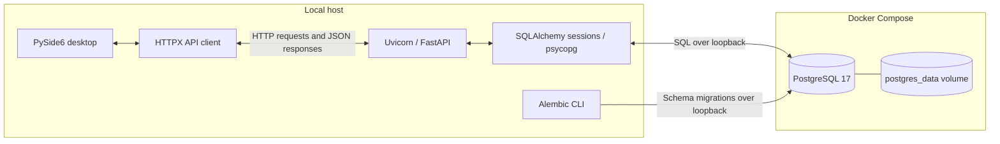

# Miner Project Hub architecture

Miner Project Hub is a Python desktop application backed by a local development API and PostgreSQL. The desktop and API run as separate processes. Docker Compose runs the database, and Alembic manages its schema.

## Desktop and API communication

The [desktop entry point](../desktop/main.py) starts the PySide6 application. The [main window](../desktop/app_window.py) owns the sidebar and selected project. My Projects lists and filters projects, opens a workspace, and submits the creation form. The workspace shows project metadata in Overview and provides project-scoped Tasks and Team tabs.

Widgets call the [HTTPX API client](../desktop/services/api_client.py) synchronously. It reads `API_BASE_URL` from the environment or repository `.env` and defaults to `http://127.0.0.1:8000`. The client sends JSON for create and update requests, checks HTTP status codes, and decodes JSON responses. The desktop reaches the database through the API. It uses explicit requests and refreshes after writes. When a task list fails to load during a project switch, the Tasks tab clears the previous rows and offers a retry for the current project.

[FastAPI](../server/main.py) registers routers for projects, tasks, users, project memberships, and authentication. [Pydantic schemas](../server/schemas.py) validate request bodies and shape responses. Database-backed handlers receive a [SQLAlchemy session](../server/database.py) per request, query or commit changes using the psycopg driver, and return the result to the desktop. `GET /health` checks API liveness independently of PostgreSQL. `GET /health/db` runs `SELECT 1` to check database connectivity.

## Current API routes

| Method | Path | Behavior |
| --- | --- | --- |
| GET | `/health` | Returns API liveness. |
| GET | `/health/db` | Returns database connectivity status. Returns 503 on a SQLAlchemy connection or query error. |
| GET | `/projects` | Lists all projects, newest ID first. |
| POST | `/projects` | Creates a project from its name, description, deadline, and team name. Returns 201. Description defaults to an empty string. Deadline and team name are optional. |
| GET | `/projects/{project_id}/tasks` | Lists tasks for the project. |
| POST | `/projects/{project_id}/tasks` | Creates a pending task from its title. Returns 201. |
| PATCH | `/projects/{project_id}/tasks/{task_id}` | Sets `is_complete` to true or false. The task must belong to the project in the path. |
| GET | `/users` | Lists development user records, including email and account role. |
| POST | `/users` | Creates a passwordless development Student. Returns 201, or 409 for a duplicate normalized email. |
| GET | `/projects/{project_id}/members` | Lists memberships joined to user details. |
| POST | `/projects/{project_id}/members` | Adds an existing user to a project with a project role. Returns 201, or 409 for a duplicate membership. |
| DELETE | `/projects/{project_id}/members/{membership_id}` | Removes a membership from the specified project and returns 204. The user record remains. |
| POST | `/auth/register` | Creates a Student with password credentials. Returns 201 or 409 for an existing email. |
| POST | `/auth/login` | Returns an expiring bearer token for valid credentials. Returns 401 for invalid credentials. |
| GET | `/auth/me` | Returns the user for a valid bearer token. Returns 401 for a missing, invalid, revoked, or expired token. |
| POST | `/auth/logout` | Revokes the current bearer session and returns 204. Requires a valid token. |

FastAPI returns 422 for request validation errors. Project-scoped handlers return 404 when a required record is missing or a task or membership ID belongs to another project. These checks enforce resource consistency. Caller permissions are still planned. FastAPI generates `/docs`, `/redoc`, and `/openapi.json`.

## PostgreSQL models

[SQLAlchemy models](../server/models.py) define the following tables. Project, task, user, and membership tables have integer primary keys named `id`. Authentication sessions use the token digest as the primary key.

| Model / table | Fields and constraints |
| --- | --- |
| `Project` / `projects` | Required `name` (120 characters) and `description` (500). Optional `deadline` (date) and `team_name` (120). `created_at` is a timezone-aware timestamp defaulted by PostgreSQL. |
| `Task` / `tasks` | Indexed `project_id` foreign key, required `title` (200), and `is_complete` (boolean, defaults to false). Deleting a project cascades to its tasks. |
| `User` / `users` | Required `name` (120), unique `email` (255), and `account_role` (20). Public creation assigns `Student`. Trusted provisioning can assign `Professor`. A nullable `password_hash` stores the Argon2id hash when credentials are established. |
| `ProjectMembership` / `project_memberships` | `project_id` and `user_id` foreign keys with a unique constraint on the pair. The API accepts `Member`, `Team Lead`, or `Reviewer` for `project_role` (30). Deleting either parent cascades to its memberships. |
| `AuthSession` / `auth_sessions` | SHA-256 `token_digest` (64 characters), indexed `user_id` foreign key, and timezone-aware `expires_at`. Deleting a user cascades to the user's sessions. |

Memberships link users and projects in a many-to-many relationship. A project's `team_name` is optional display metadata; memberships track the actual roster.

## Local Docker setup and migrations

[Docker Compose](../compose.yaml) runs `postgres:17-alpine`, checks readiness with `pg_isready`, and stores data in the named `postgres_data` volume. PostgreSQL listens on port 5432 in the container. Compose publishes it only on host loopback, using `POSTGRES_PORT` or 5432 by default. The API and Alembic read the `POSTGRES_*` settings from the environment or repository `.env`. The desktop uses only the API address.

Run `docker compose up -d db`, then `python -m alembic upgrade head` before starting the API. See the [local setup instructions](../README.md#run-locally-macos-linux-or-windows). [Alembic](../alembic/env.py) uses the server's connection settings and SQLAlchemy metadata. The current [revision chain](../alembic/versions) is:

| Revision | Schema change |
| --- | --- |
| `0001` | Creates projects. |
| `7668de201b35` | Adds project tasks. |
| `c4d8bdf07474` | Adds users and project memberships. |
| `b7e3a91c42d0` | Adds nullable project deadline and team name, preserving existing projects. |
| `6c7ab719eb23` | Adds nullable user password hashes and creates authentication sessions. |

[GitHub Actions](../.github/workflows/tests.yml) runs API and Qt checks and enables the PostgreSQL integration suite. The integration tests start a disposable PostgreSQL 17 container, apply the migrations, check for schema drift, and exercise the API and database constraints. The development database is outside that test setup.

## Implemented and planned functionality

| Area | Implemented | Planned |
| --- | --- | --- |
| Projects and tasks | Global project listing and creation, saved project metadata, project-scoped task listing and creation, and task completion. The API also supports reopening tasks. | Personal and class project workflows, ownership, and additional editing and deletion actions. |
| Users and teams | Development user records and project membership listing, addition, and removal. | Student invitations and professor-managed class rosters. |
| Authentication | Student registration, email/password login, current user, and logout. Trusted operators can provision Professor accounts and activate passwordless records. | PySide6 login and session handling. |
| Authorization | Account and project roles are stored as labels. They grant no permissions today. | FastAPI will enforce access based on the authenticated user, project ownership, membership, and role. The desktop will provide role-specific workflows. |
| Files and other pages | Files can be selected and removed locally. Diagrams, Activity, Courses, Reviews, and Settings have placeholders. | Shared file storage, authorized uploads and downloads, and the remaining project and course workflows. |

Keep the current API in local development. Shared deployment requires HTTPS and access controls on business routes. See the [authentication guide](authentication.md) for provisioning and session details. PostgreSQL credentials belong on the server side.
